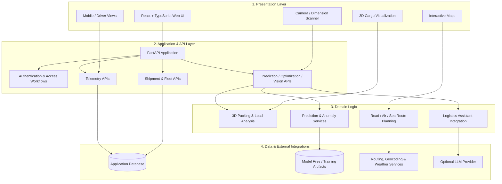
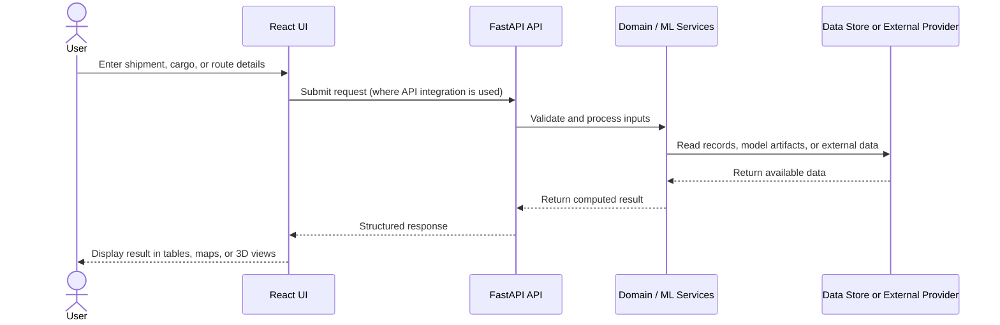
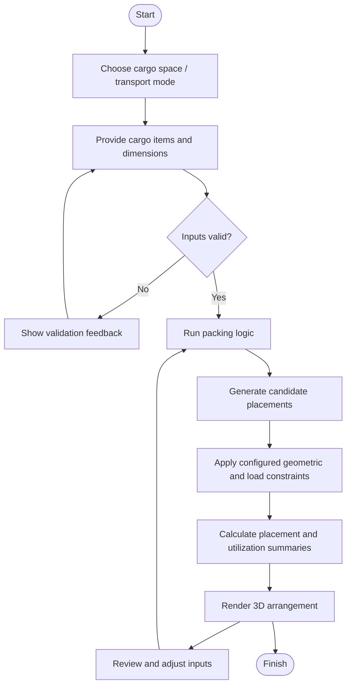
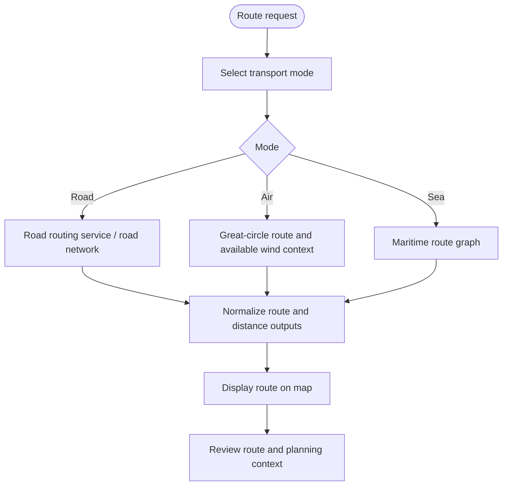

# OptiLoad 3D — Intelligent Multimodal Logistics & Cargo Optimization

<p align="center">
  <strong>Plan smarter routes. Load cargo more efficiently. Observe logistics operations in one workspace.</strong>
</p>

<p align="center">
  <a href="https://github.com/harshit-glitch24/OPTILOAD_Major_Project"></a>
  
  
  
  
</p>

> **Project status:** Academic major project under active development. Feature maturity varies by subsystem; see [Implementation Status](#implementation-status) and the [Reality Gap Report](REALITY_GAP_REPORT.md) for details.

---

## Table of Contents

- [Overview](#overview)
- [Problem Statement](#problem-statement)
- [Project Objectives](#project-objectives)
- [System Capabilities](#system-capabilities)
- [High-Level Architecture](#high-level-architecture)
- [Core Data Flow](#core-data-flow)
- [Cargo Optimization Workflow](#cargo-optimization-workflow)
- [Routing Workflow](#routing-workflow)
- [Technology Stack](#technology-stack)
- [Repository Structure](#repository-structure)
- [Getting Started](#getting-started)
- [Configuration](#configuration)
- [Testing and Validation](#testing-and-validation)
- [Implementation Status](#implementation-status)
- [Project Documentation](#project-documentation)
- [Security and Data Integrity](#security-and-data-integrity)
- [Roadmap](#roadmap)
- [Contributors](#contributors)
- [License](#license)

---

## Overview

**OptiLoad 3D (also referred to as LogiLoad India)** is a logistics planning and visualization project that brings together shipment and fleet workflows, multimodal route planning, 3D cargo placement, cargo-dimension estimation, and AI/ML-assisted decision-support into a single web application.

The project is designed around a practical logistics question:

> **Given a shipment, a vehicle or transport mode, and operational constraints, how can we plan its route and cargo arrangement while making the underlying decisions visible to the user?**

The application combines a React and TypeScript interface with interactive maps and 3D visualization. A FastAPI backend provides API endpoints for application workflows, while Python modules contain prediction, anomaly-analysis, and optimization experiments.

## Problem Statement

Logistics planning spans several connected decisions, but these are often handled in separate tools or through manual processes:

- **Cargo capacity:** estimating whether items can fit within a truck or other cargo space.
- **Load arrangement:** visualizing placements and understanding basic weight distribution.
- **Route planning:** comparing routes across road, air, and maritime modes.
- **Shipment visibility:** viewing shipment, fleet, and telemetry-related information.
- **Decision support:** exploring delay, cost, demand, anomaly, and optimization signals without treating every model output as ground truth.

OptiLoad provides a unified prototype for exploring these workflows. It is an academic engineering project and is **not represented as a certified safety-critical logistics system**.

## Project Objectives

1. **Unify logistics workflows** in one interface for shipment, fleet, route, and cargo-planning tasks.
2. **Visualize cargo in 3D** to make item placement and container utilization easier to inspect.
3. **Represent multimodal routes** using mode-appropriate routing methods and external geographic services where configured.
4. **Explore AI/ML decision support** for predictions, anomaly detection, and optimization.
5. **Expose assumptions and limitations** so users can distinguish implemented algorithms, external service responses, synthetic data, and simulation.
6. **Support iterative validation** through documented setup, test workflows, and reproducible model evaluation.

## System Capabilities

| Area | Purpose | Implementation notes |
|---|---|---|
| Logistics workspace | Interface for core logistics workflows | React/TypeScript application |
| Cargo loading visualization | Arrange items within a defined cargo envelope | Deterministic packing logic and 3D visualization are present in the codebase |
| Multimodal routing | Explore road, air, and maritime paths | Uses mode-specific routing approaches; external services may be required |
| Shipment and fleet workflows | Manage or display shipment and vehicle records | FastAPI routers and data models are included |
| Telemetry views | Display vehicle/sensor-related information | Some flows are simulated; inspect the reality-gap report before interpreting data as live |
| Cargo dimension estimation | Estimate dimensions from a camera view/reference | OpenCV-based image processing; not a certified metrology device |
| AI/ML decision support | Explore delay, freight-cost, demand, anomaly, routing, and packing models | Maturity and data provenance differ by subsystem |
| Logistics assistant | Natural-language interaction with logistics data where configured | External model/API credentials may be needed |
| Reports and exports | Generate selected client-side reports/documents | Check feature behavior in the current application |

## High-Level Architecture

The architecture below shows the main logical layers and their relationships. It is a **conceptual view of the repository**, not a claim that every service is independently deployed or production-hardened.



### Architecture principles

- **Separation of concerns:** UI, API routes, logistics services, and ML code have distinct areas in the repository.
- **Mode-aware planning:** road, air, maritime, and cargo-placement workflows use different constraints and algorithms.
- **Visual explainability:** map and 3D views help users inspect planning outputs.
- **Honest data provenance:** live external responses, locally computed results, model predictions, and simulated values should remain distinguishable.

## Core Data Flow

This flow illustrates a typical request-response path. Exact paths can vary according to the feature being used.



## Cargo Optimization Workflow

The cargo workflow is intended to make item placement inspectable. A packing result depends on item dimensions, the cargo-space dimensions, and any constraints enforced by the selected packing mode.



> **Interpretation note:** This flow describes the intended application workflow. Do not assume all physical constraints, axle loads, stability rules, or reinforcement-learning policies are fully validated merely because a visualization or model module exists.

## Routing Workflow



Route availability and output quality depend on the selected algorithm, configured data, network connectivity, and the limitations of external services.

## Technology Stack

### Frontend

- **React 19** and **TypeScript**
- **Vite** for development and bundling
- **Three.js**, **React Three Fiber**, and **Drei** for 3D visualization
- **Leaflet** and **React Leaflet** for maps
- **React Router** for client-side navigation
- **Recharts** for selected data visualizations
- **Lucide React** for interface icons

### Backend and data

- **FastAPI** for Python API endpoints
- **SQLite / SQLAlchemy-related components** in the backend implementation
- **Pydantic** schemas for API data validation
- **Firebase** packages/configuration for applicable client integrations

### AI, ML, and computer vision

- **PyTorch**
- **Scikit-learn**
- **OpenCV**
- Model-specific preprocessing, inference, and evaluation scripts under `ml/`

### Routing and external services

- **OSRM** for road routing
- **Photon / Nominatim / OpenStreetMap** for location search/geocoding, subject to their service policies
- **Open-Meteo** for available weather/wind data
- **searoute-ts** for maritime route graph calculations
- **OpenRouter** as an optional LLM provider, when configured

The frontend dependencies can be reviewed in `package.json`; Python dependencies are listed in `backend/requirements.txt` and other ML-specific dependency files where present.

## Repository Structure

The repository contains a web application, backend API, logistics services, ML modules, test configuration, and project documentation. Key locations include:

| Path | Responsibility |
|---|---|
| `App.tsx`, `index.tsx` | Frontend entry points and application shell |
| `components/` | Reusable UI components, including 3D/camera-related components |
| `pages/` | Feature-level screens and route planners |
| `contexts/`, `hooks/` | Shared application state and reusable hooks |
| `services/` | Client-side logistics logic and integrations |
| `backend/main.py` | FastAPI application entry point |
| `backend/routers/` | API route modules for auth, fleet, shipments, telemetry, and AI-related workflows |
| `backend/models.py`, `backend/schemas.py` | Data models and API schemas |
| `backend/database.py`, `backend/seed.py` | Database setup and seed utilities |
| `ml/models/` | Model/inference modules |
| `ml/data/` | Data-generation or dataset-related utilities |
| `tests/` | Test files |
| `playwright.config.ts` | Browser test configuration |
| `AI_ML_ALGORITHMS_REFERENCE.md` | Detailed AI/ML algorithm notes and code pointers |
| `REALITY_GAP_REPORT.md` | Audit of real, synthetic, hybrid, heuristic, and simulated components |
| `REAL_DATASET_RECOMMENDATIONS.md` | Recommendations for improving dataset provenance |
| `OptiLoad_Complete_Project_Master_Report.pdf` | Project master report |
| `MAJOR PROJECT DETAILS.pdf` | Major-project reference document |

> This is a navigation summary, not an exhaustive listing of every file.

## Getting Started

### Prerequisites

- Node.js and npm (use a current LTS release)
- Python 3.10 or newer recommended for the backend/ML environment
- Git
- Optional API credentials for integrations you intend to enable

### 1. Clone the repository

```bash
git clone https://github.com/harshit-glitch24/OPTILOAD_Major_Project.git
cd OPTILOAD_Major_Project
```

### 2. Install frontend dependencies

```bash
npm install
```

### 3. Configure environment variables

Create a local environment file from the example:

**Windows PowerShell**
```powershell
Copy-Item .env.example .env
```

**macOS / Linux**
```bash
cp .env.example .env
```

Review `.env.example` and add only the credentials required for the integrations you want to use. Optional providers may work without credentials, but their associated features may be unavailable.

### 4. Start the frontend

```bash
npm run dev
```

Vite is configured to use port `3000` for local development. Open the local URL printed in the terminal.

### 5. Start the backend (when using API-backed features)

Open a second terminal:

```bash
cd backend
python -m venv .venv
```

Activate the environment:

**Windows PowerShell**
```powershell
.\.venv\Scripts\Activate.ps1
```

**macOS / Linux**
```bash
source .venv/bin/activate
```

Install backend dependencies and start FastAPI:

```bash
pip install -r requirements.txt
uvicorn main:app --reload --host 127.0.0.1 --port 8000
```

If your local configuration or code expects different backend settings, use the configuration documented in `backend/config.py` and the relevant router modules. API-backed functionality requires the backend to be running and correctly configured.

## Configuration

Environment variables and provider requirements may change as the project evolves. Start with `.env.example` and the configuration files in the repository.

| Variable / integration | Purpose | Notes |
|---|---|---|
| `VITE_USE_MOCK_DATA` | Controls the documented mock-data setting | Confirm the relevant feature honors the setting before relying on it |
| `VITE_OPENROUTER_API_KEY` | Optional LLM integration | Keep private credentials local; do not commit real keys |
| OSRM | Road route requests | Public endpoint availability and usage limits are outside this repository's control |
| Photon / Nominatim | Location search/geocoding | Follow provider usage policies and attribution requirements |
| Open-Meteo | Weather/wind context | Service coverage and response freshness may vary |

Never place secrets in source code or commit an actual `.env` file.

## Testing and Validation

The repository includes a Playwright test configuration and npm scripts.

Run the configured browser tests with:

```bash
npm test
```

Run a production frontend build with:

```bash
npm run build
```

A successful build confirms that the frontend bundle can be produced; it does not by itself validate routing accuracy, physical load stability, model performance, security, or production readiness. Validate those properties with feature-specific tests and recorded datasets.

For ML-related work, report dataset provenance, train/validation/test split methodology, baselines, metrics, and known limitations alongside any performance figures.

## Implementation Status

This project contains a mixture of implemented application code, deterministic algorithms, externally integrated features, experimental ML components, and simulated telemetry. The repository's own audit documents important differences:

| Subsystem | Current characterization in repository audit |
|---|---|
| Road route planning | Uses an external OSRM routing service |
| Air route planning | Great-circle/geodesic route logic with available wind-data integration |
| Maritime route planning | Graph-based route calculation using `searoute-ts` |
| Deterministic 3D packing | Maximal-cuboid-style heuristic implementation |
| Center-of-gravity visualization | Calculation/visualization from cargo placement and weight data |
| Delay, cost, demand and anomaly ML | Model implementations exist; the audit flags synthetic training/data assumptions for several models |
| RL-inspired route and cargo policies | Hybrid/heuristic behavior; full training and benchmark validation remain work items in the audit |
| Camera dimension estimation | OpenCV edge/contour and reference-scale approach; not deep-learning-based metrology |
| GPS and cold-chain telemetry | Some dashboard values are simulated rather than hardware-fed live telemetry |
| Logistics assistant | LLM integration may require external provider configuration |

For the detailed evidence and remediation plan, read **[REALITY_GAP_REPORT.md](REALITY_GAP_REPORT.md)**. For algorithm descriptions, read **[AI_ML_ALGORITHMS_REFERENCE.md](AI_ML_ALGORITHMS_REFERENCE.md)**. Treat benchmark numbers in secondary documentation as claims to verify against reproducible training/evaluation runs before using them in a presentation or report.


## Architecture Documentation

For a deeper technical view, see the dedicated **[Architecture Documentation](docs/architecture/README.md)**:

- [System Architecture](docs/architecture/system-architecture.md) — layered architecture and component responsibilities.
- [Module Map](docs/architecture/module-map.md) — where the major frontend, backend, domain, and ML modules live.
- [Workflow Diagrams](docs/architecture/workflows.md) — request lifecycle, cargo packing, multimodal routing, and AI-assisted analysis.

## Project Documentation

- **[Reality Gap Report](REALITY_GAP_REPORT.md)** — current implementation, data provenance, limitations, and engineering roadmap.
- **[AI/ML Algorithms Reference](AI_ML_ALGORITHMS_REFERENCE.md)** — model and algorithm descriptions with code pointers.
- **[Real Dataset Recommendations](REAL_DATASET_RECOMMENDATIONS.md)** — suggested steps for improving dataset quality and provenance.
- **[Complete Project Master Report (PDF)](OptiLoad_Complete_Project_Master_Report.pdf)**.
- **[Major Project Details (PDF)](MAJOR%20PROJECT%20DETAILS.pdf)**.

## Security and Data Integrity

- Use local environment variables for credentials; do not commit API keys, tokens, private certificates, or production data.
- Treat shipment and telemetry records as sensitive operational data.
- Validate input at API boundaries and restrict database access to trusted server-side code.
- Apply provider attribution, quotas, and terms of use for external routing/geocoding/weather APIs.
- Treat model outputs as decision support, not guaranteed operational truth.
- Clearly label simulated telemetry and synthetic training data in demos, reports, and screenshots.
- Do not use the project as the sole basis for actual load-safety, aircraft trim, road-safety, or commercial dispatch decisions without independent validation.

## Roadmap

The following items summarize the direction described in the repository's audit documentation:

- [ ] Replace synthetic training sources with documented, suitable real-world datasets where available.
- [ ] Make training/evaluation pipelines reproducible and compare models against baselines.
- [ ] Benchmark route and cargo optimization policies against deterministic baselines.
- [ ] Integrate authenticated telemetry ingestion for hardware-backed GPS and sensor data.
- [ ] Improve camera-based dimension estimation and quantify calibration error.
- [ ] Expand automated tests and add feature-specific validation for core workflows.
- [ ] Document deployment configuration, operational limits, and security requirements.

## Contributors

This is an academic team project. Add or update contributor names, roles, and links here in coordination with the project team.

- **Project:** OptiLoad 3D / LogiLoad India
- **Repository:** [harshit-glitch24/OPTILOAD_Major_Project](https://github.com/harshit-glitch24/OPTILOAD_Major_Project)

## License

No explicit open-source license file was identified in the repository during README preparation. Unless the team adds a license, usage and redistribution permissions should not be assumed. Add the license approved by your team/institution before presenting the repository as open source.
