# Repository Module Map

This document connects the major functional areas of OptiLoad 3D to the repository locations that help a developer navigate the codebase. Paths are representative entry points; inspect imports and route registration for the complete dependency graph.

## 1. Module overview

```mermaid
flowchart TD
    ROOT["Application Repository"]
    ROOT --> FRONT["Frontend Application"]
    ROOT --> BACK["FastAPI Backend"]
    ROOT --> DOMAIN["Logistics Services"]
    ROOT --> ML["ML / Vision Modules"]
    ROOT --> DOCS["Project Documentation"]

    FRONT --> APP["App.tsx / entry points"]
    FRONT --> PAGES["pages/"]
    FRONT --> COMPONENTS["components/"]
    FRONT --> CONTEXT["contexts/ and hooks/"]
    FRONT --> SERVICES["services/"]

    BACK --> MAIN["backend/main.py"]
    BACK --> ROUTERS["backend/routers/"]
    BACK --> MODELS["backend/models.py"]
    BACK --> SCHEMAS["backend/schemas.py"]
    BACK --> DB["backend/database.py"]

    DOMAIN --> PACK["Packing logic"]
    DOMAIN --> ROUTING["Route planning"]
    ML --> MODELSML["ml/models/"]
    ML --> DATA["ml/data/"]

    DOCS --> ARCH["docs/architecture/"]
    DOCS --> AUDIT["REALITY_GAP_REPORT.md"]
    DOCS --> ALGO["AI_ML_ALGORITHMS_REFERENCE.md"]
```

## 2. Key directories and files

| Path | Role |
|---|---|
| `App.tsx` | Main React application shell |
| `components/` | Reusable UI components, including camera and visualization components |
| `pages/` | Feature screens and route-planning pages |
| `contexts/` | Shared React state/context, where used |
| `hooks/` | Reusable client-side hooks |
| `services/` | Client-side domain logic and integrations, including packing/routing-related modules |
| `backend/main.py` | FastAPI application entry point and router wiring |
| `backend/routers/auth_router.py` | Authentication API routes |
| `backend/routers/fleet_router.py` | Fleet-related API routes |
| `backend/routers/shipments_router.py` | Shipment-related API routes |
| `backend/routers/telemetry_router.py` | Telemetry API routes |
| `backend/routers/ai_prediction_router.py` | Prediction-related API routes |
| `backend/routers/ai_anomaly_router.py` | Anomaly-analysis API routes |
| `backend/routers/ai_optimization_router.py` | Optimization-related API routes |
| `backend/routers/ai_vision_router.py` | Vision-related API routes |
| `backend/routers/ai_chat_router.py` | Logistics assistant / chat integration |
| `backend/models.py` | Backend data models |
| `backend/schemas.py` | Request/response schemas |
| `backend/database.py` | Database setup helpers |
| `backend/seed.py` | Seed/demo-data utilities |
| `ml/models/` | Python model and inference modules |
| `ml/data/` | Data utilities and generators |
| `AI_ML_ALGORITHMS_REFERENCE.md` | Detailed algorithm and model reference |
| `REALITY_GAP_REPORT.md` | Evidence-oriented status and limitation audit |
| `REAL_DATASET_RECOMMENDATIONS.md` | Dataset provenance and upgrade recommendations |

## 3. How to trace a feature

For any feature, trace it through these steps:

1. Find the page or component that initiates the action.
2. Identify the imported service or API client.
3. Follow the request to the matching backend router, if the feature is API-backed.
4. Inspect schema validation and the domain/model function called by the route.
5. Identify where the output is computed or persisted.
6. Check tests, fallback behavior, and whether displayed data is live, external, synthetic, or simulated.

## 4. Source-of-truth rule

The module map is an orientation guide. If a path, function, or feature description conflicts with the current code, the implementation wins. Update this document when routes or modules are renamed.
