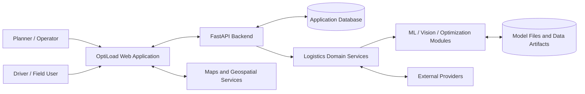
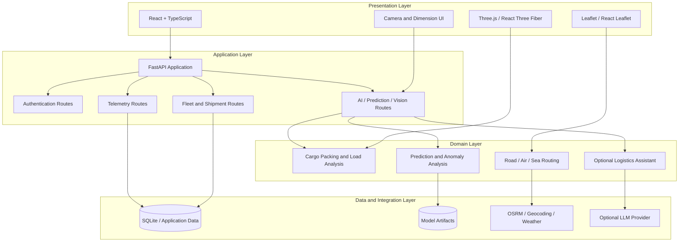

# System Architecture

## 1. Purpose

OptiLoad 3D is a logistics-planning application that brings together shipment/fleet workflows, multimodal route planning, 3D cargo visualization, and AI/ML-oriented decision-support modules.

The system is described as four logical areas:

1. **Presentation:** browser UI, maps, 3D scene, and camera/driver-facing views.
2. **Application/API:** FastAPI routes for supported backend workflows.
3. **Domain services:** cargo packing, route planning, prediction, anomaly analysis, and assistant integrations.
4. **Data and integrations:** application persistence, model artifacts, and external providers.

## 2. Context diagram

## 3. Layered architecture

## 4. Component responsibilities

| Component | Responsibility | Boundary / caveat |
|---|---|---|
| React + TypeScript UI | User interaction, navigation, forms, and visualization | Client-side behavior is not itself proof of server persistence |
| Map components | Present route geometry and location context | Route quality depends on algorithm and provider availability |
| 3D scene | Render cargo-space and item-placement results | Rendering does not certify physical stability or load safety |
| FastAPI app | Expose supported backend workflows | Actual availability depends on local configuration and runtime |
| Backend routers | Group auth, fleet, shipment, telemetry, and AI-related endpoints | Review each router for the current contract and access controls |
| Logistics services | Implement packing and route-related logic | Distinguish deterministic algorithms from experimental policies |
| ML modules | Provide prediction, anomaly, vision, and optimization experiments | Check dataset provenance, model artifacts, evaluation splits, and baselines |
| Data store | Persist supported application records | Do not assume all displayed demo values originate from persistent records |
| External providers | Supply route, geocoding, weather, or LLM functionality | May require internet access, keys, attribution, and rate-limit handling |

## 5. Main technology boundaries

- **Frontend:** React 19, TypeScript, Vite, React Router, Leaflet, Three.js ecosystem.
- **Backend:** FastAPI, Python schemas and backend data models.
- **AI/ML and vision:** PyTorch, scikit-learn, OpenCV, and related Python modules.
- **External integrations:** OSRM, OpenStreetMap-based geocoding, Open-Meteo, maritime route graph package, and optional LLM provider.
- **Client integrations:** Firebase-related dependencies/configuration are present; check the specific feature's runtime configuration before assuming a workflow relies on Firebase.

## 6. Runtime boundaries and assumptions

- The frontend development server and FastAPI backend are separate local processes in the standard developer workflow.
- External APIs are dependencies, not services controlled by this repository.
- Some telemetry views are simulated, and several model pipelines use synthetic data according to [REALITY_GAP_REPORT.md](../../REALITY_GAP_REPORT.md).
- This architecture is a logical reference for the current repository, not a deployment topology, SLA, security certification, or claim of production readiness.
