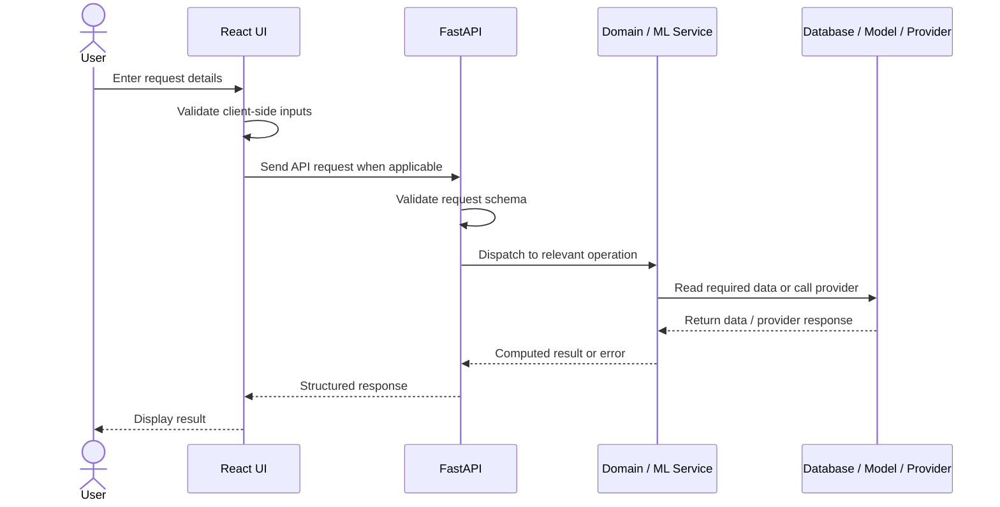
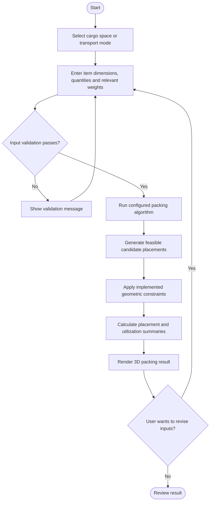
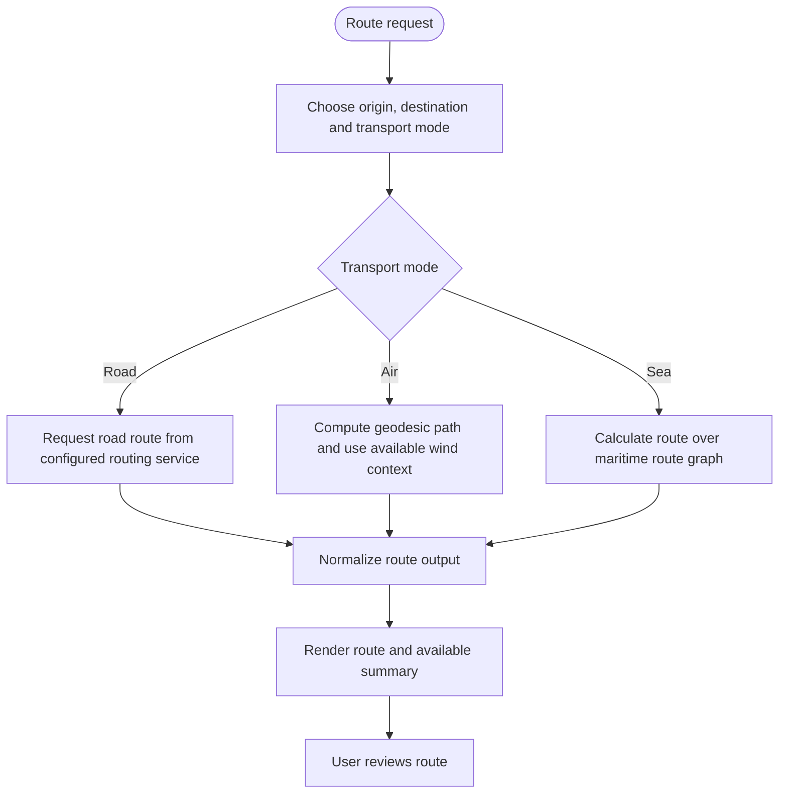
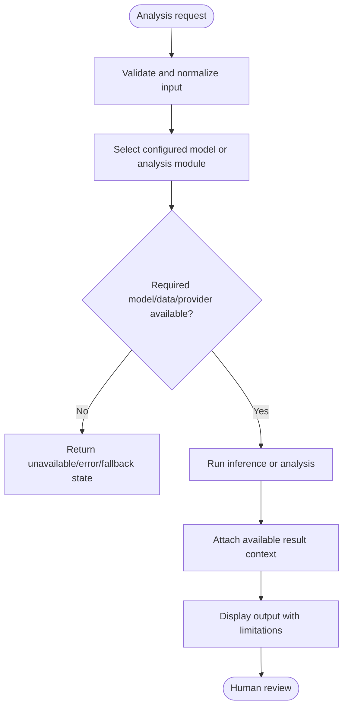
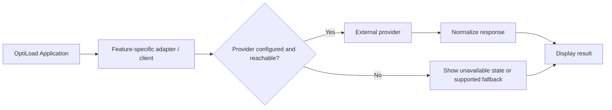

# Core Workflow Diagrams

These diagrams document the principal logical workflows at a high level. They describe the intended flow through the application and should be checked against the relevant code whenever implementation changes.

## 1. General request lifecycle

## 2. Cargo packing workflow

**Important:** the exact constraints enforced depend on the selected implementation. A rendered result is not proof of certified stability, axle-load compliance, or safe operational loading.

## 3. Multimodal routing workflow

## 4. Prediction / AI-assisted analysis workflow

The AI/ML modules have different levels of maturity. Some training data is synthetic, some optimization policies are hybrid/heuristic, and some telemetry is simulated; see [REALITY_GAP_REPORT.md](../../REALITY_GAP_REPORT.md) before interpreting outputs as validated operational predictions.

## 5. External integration boundary

Provider errors, network failure, quota limits, and stale data should be handled explicitly. A fallback should not silently be presented as live external data.
